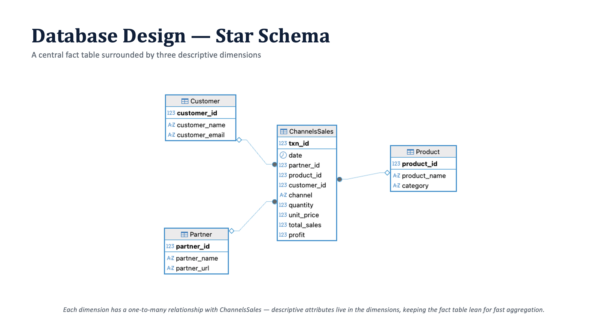
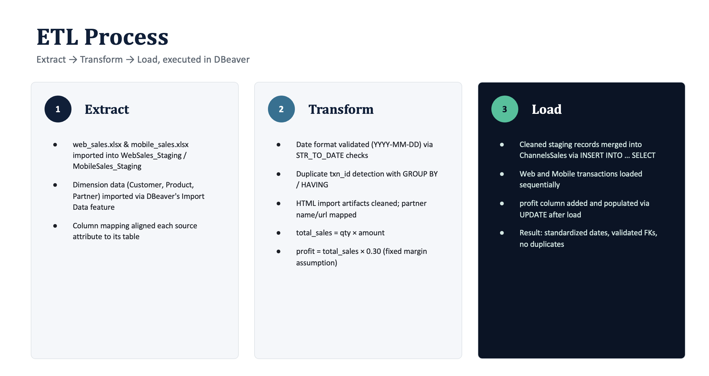
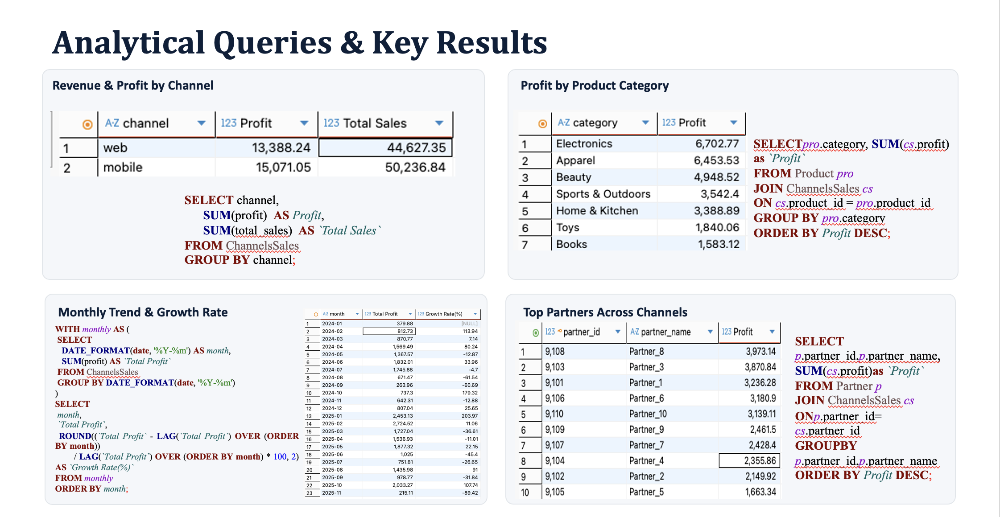
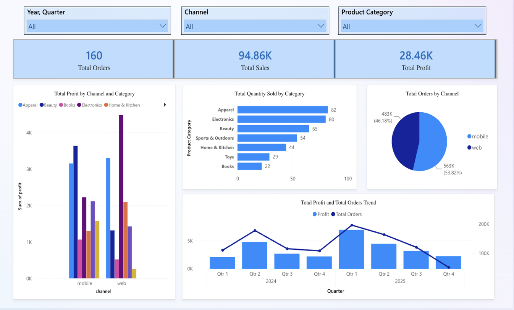
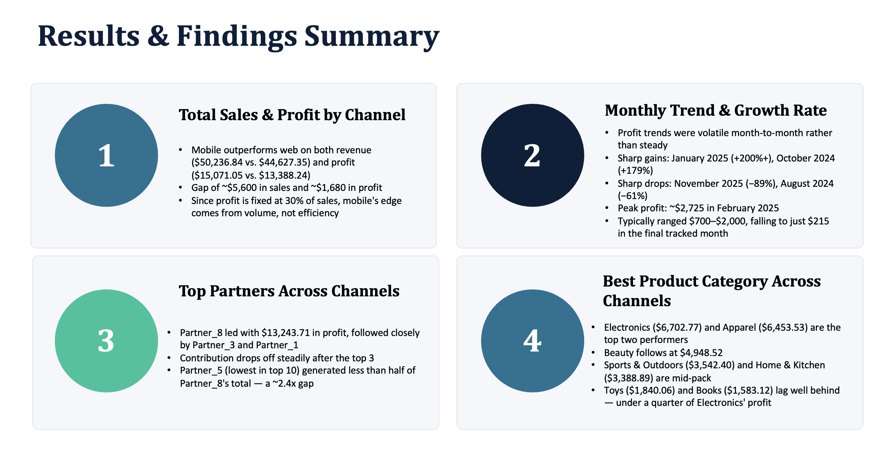
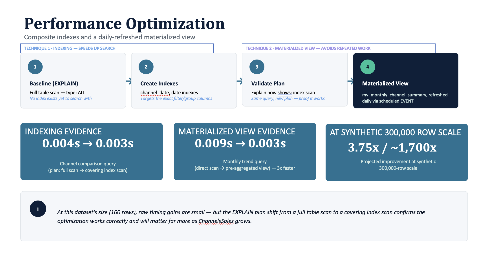

# E-Commerce Multi-Channel Analytics

## Project Overview

This project focuses on combining sales data from different e-commerce channels into a single database to make business analysis easier.

Our team worked with web sales, mobile sales, and partner information. We designed a relational database, cleaned and organized the data, performed SQL analysis, and created a Power BI dashboard to understand sales performance.

The main goal was to make it easier to compare sales channels, identify profitable product categories, and track business performance.

## Project Objectives

- Combine sales data from multiple sources into one database.
- Design a relational database using a star schema.
- Clean and transform data using an ETL process.
- Analyze revenue, profit, and sales trends using SQL.
- Improve database performance through indexing.
- Create a Power BI dashboard to visualize business performance.
- Implement database security using different user roles.

## Tools Used

- SQL
- MySQL
- DBeaver
- Power BI
- Google Cloud SQL

## Dataset Description

The project used sales information from different sources:

- Web sales data (CSV)
- Mobile sales data (Excel)
- Partner information (HTML)
- Product information
- Customer information

The product and customer datasets were created for the project because they were not available in the original source files.

## Database Design

We designed a star schema to organize the sales data.

The main table, **ChannelsSales**, stores transaction information such as sales dates, quantities, prices, revenue, and profit.

The database also includes three supporting tables:

- Customer
- Product
- Partner

These tables are connected through relationships that help organize the data and support SQL analysis.

### Database Star Schema

## Data Cleaning and ETL

We used an ETL (Extract, Transform, Load) process to prepare the data.

The process included:

1. Importing data from different sources into staging tables.
2. Checking date formats and identifying duplicate transactions.
3. Cleaning and organizing the data.
4. Calculating total sales and profit.
5. Loading the cleaned records into the main database.

For this project, profit was calculated using an assumed 30% margin.

### ETL Process

## SQL Analysis

We wrote SQL queries to answer important business questions, including:

- Which sales channel generates the highest revenue?
- Which product categories contribute the most profit?
- How does monthly profit change over time?
- Which partners contribute the most to sales performance?

We also used indexes and a pre-aggregated summary table to improve query performance.

### SQL Queries and Results

## Power BI Dashboard

We created a Power BI dashboard to present the results in a simple and interactive format.

The dashboard includes:

- Total orders
- Total sales
- Total profit
- Sales performance by channel
- Profit by product category
- Quarterly sales trends

Users can filter the dashboard by year, quarter, sales channel, and product category.

### Power BI Dashboard Visualization

## Key Findings

Our analysis highlighted several useful business insights.

### 1. Mobile Sales Performed Better

Mobile sales generated approximately $50,236 in revenue, compared with $44,627 from web sales.

### 2. Electronics Was the Most Profitable Category

Electronics generated approximately $6,703 in profit, followed by Apparel at approximately $6,454.

### 3. Sales Performance Changed Over Time

Monthly sales and profit showed fluctuations, highlighting the importance of tracking business performance regularly.

### 4. Partner Performance Varied

Some partners contributed significantly more profit than others, showing opportunities to improve partner relationships and marketing strategies.

### Key Findings Summary

## Performance Optimization and Security

We improved database query performance using indexes and pre-aggregated summaries.

We also implemented different database roles to control access, including analyst, administrator, auditor, and marketing permissions.

This helped demonstrate how database security and performance optimization support business reporting.

### Performance Optimization

## What I Learned

This project helped me understand how databases and business intelligence tools work together.

I gained practical experience in database design, SQL analysis, ETL processes, and interpreting business performance.

It also helped me understand how organized data can support better business decisions.

## Author

Moksha Ramchetty

